::: cover
*1. Cover Page*

**ABU DHABI UNIVERSITY**

College of Engineering — Department of Computer Science and Information Technology

**CSE410 – Mobile Device Security**

# Automated Mobile Security Assessment using DIVA and MobSF

Laboratory Exercise Report — CLO1: Implement an automated security assessment of mobile devices

| | |
|---|---|
| **Semester** | Fall 2026–2027 |
| **Instructor** | Dr. Muhammad Nasir Mumtaz Bhutta |
| **Student Name(s)** | `[Student Name]` |
| **Student ID(s)** | `[Student ID]` |
| **Group ID** | `[Group ID]` |
| **Submission Date** | `[DD Month 2026]` (deadline: Sunday 1 November 2026) |
| **Assessment Date** | 28 October 2026 |
:::

# 2. Executive Summary

This lab implemented an automated static security assessment of DIVA (Damn Insecure and Vulnerable App for Android), an intentionally vulnerable application supplied for education. The DIVA source code was obtained from the official Payatu repository, its native library was compiled with `make`/`ndk-build`, and the application was built into a signed debug APK (`diva-app-debug.apk`, package `jakhar.aseem.diva`). The APK was then uploaded to a local MobSF v4.6.2 instance running in Docker, which performed manifest, certificate, code (SAST), binary, API and secret analysis.

MobSF gave the application a **security score of 47/100 (Grade B, “Medium Risk”)** and reported **2 High, 8 Medium (warning), 1 Info, 1 Secure and 1 Hotspot** finding. Five findings were selected, analysed and prioritised:

1. **Unprotected exported Content Provider** (`.NotesProvider`) – any installed app can read, change and delete the private notes. **High priority, fixed first.**
2. **SQL injection** through a raw, string-concatenated SQL query in `SQLInjectionActivity` – dumps every stored user, password and credit card number. **High.**
3. **Credentials written to external storage** (`InsecureDataStorage4Activity`, plus a temp file in `InsecureDataStorage3Activity`) – any app with storage access can read them. **High.**
4. **Exported activities with intent filters** (`.APICredsActivity`, `.APICreds2Activity`) – any app can open the screens that show API credentials. **Medium.**
5. **Sensitive information written to the system log** (`LogActivity`: credit card numbers). **Medium.**

Validation showed that automated static analysis is useful but incomplete. The “hardcoded secret” `pkey: notespin` is a **false positive** (it is a SharedPreferences key name). Several real hardcoded secrets are **false negatives**: `vendorsecretkey`, `123secretapikey123` and the native key `olsdfgad;lh`. **Overall conclusion:** the evidence shows a weak security posture. The most important problems are broken access control on exported components, injection, and insecure storage of credentials. Each can be fixed at its root cause with the remediation in Section 11.

# 3. Introduction

Mobile applications process credentials, payment data and personal information on devices that the developer does not control. An **automated mobile application security assessment** uses tooling to inspect an application package systematically, without running it. Such a tool decompiles the code, parses the manifest, inspects certificates and native binaries, and matches the results against rule sets mapped to standards such as CWE, OWASP Mobile Top 10 and OWASP MASVS. Automation makes assessments fast, repeatable and consistent, which is why it is used in secure SDLC pipelines and as the first phase of a penetration test.

In this lab the target is **DIVA**, published by Payatu specifically to teach insecure logging, hardcoding, insecure data storage, input validation and access control flaws in both Java and native (C) code. The assessment platform is **MobSF (Mobile Security Framework)**, an open-source automated framework for Android/iOS static and dynamic analysis. The scenario is that of a junior mobile application security analyst: establish scope, prepare the target, run the automated assessment, and turn the raw results into prioritised, evidence-based findings with remediation.

# 4. Assessment Scope and Authorization

| Item | Details |
|---|---|
| **In scope** | The DIVA Android application (`jakhar.aseem.diva`, version 1.0, versionCode 1). It was built by the student from the official source `github.com/payatu/diva-android` (commit `2bb63b5`, 15 Jan 2016). The APK assessed is `diva-app-debug.apk` (SHA-256 `4adc2de8…9fa28331`). |
| **Assessment type** | Automated **static** analysis with MobSF (manifest, certificate, code/SAST, shared-library binary, Android API, permissions, secrets/strings, trackers). |
| **Out of scope / excluded** | Dynamic analysis and instrumentation (Frida/emulator), exploitation of findings, network testing, real devices, and any personal, production, university or third-party application. No other APK was uploaded to the MobSF instance. |
| **Test environment** | An isolated lab host (Ubuntu 24.04.5 LTS, x86-64). MobSF ran locally in a Docker container bound to `127.0.0.1:8000`, and only the lab operator could reach it. |
| **Authorization** | The assessment was authorised by the CSE410 laboratory exercise (Instructor: Dr. Muhammad Nasir Mumtaz Bhutta). DIVA is deliberately vulnerable and is published for educational testing. All work was done in this controlled environment. |
| **Data handling** | No personal data was used. The MobSF REST API key printed at container start-up is redacted in all evidence. Only the default lab credentials (`mobsf/mobsf`) appear, as documented by MobSF. |

# 5. Tools and Environment

| Component | Version / Detail | Purpose |
|---|---|---|
| Host operating system | Ubuntu 24.04.5 LTS, Linux 6.18 x86-64, 4 CPU / 16 GB RAM | Lab host |
| DIVA Android | `payatu/diva-android` @ `2bb63b531ba6` | Assessment target |
| Android Studio | `[record your installed version, e.g. Help → About]` | IDE used to open/sync/build the project (see 6.2) |
| Android SDK build-tools | 35.0.0 (aapt2, d8, zipalign, apksigner) | APK build toolchain (what Android Studio's Gradle build invokes) |
| Android SDK platform | android-34 (`android.jar`) | Compile SDK |
| Android NDK | 29.0.14206865 (`ndk-build`) | Native library `libdivajni.so` |
| Android Support Library | appcompat-v7 / design / support-v4 / recyclerview-v7 **23.1.0** (the exact versions DIVA declares) | App dependencies |
| Java | OpenJDK 21.0.12 | `javac`, `keytool` |
| Docker Engine | 29.9.2 (Docker Desktop on Windows/macOS provides the same engine) | Container runtime |
| MobSF | **v4.6.2**, image `opensecurity/mobile-security-framework-mobsf:latest` (digest `sha256:637cdb70…6d301`) | Automated assessment |
| JADX (used by MobSF) | 1.5.0 | DEX → Java decompilation for code analysis |
| Browser | Chromium | MobSF web interface and screenshots |

**Official references used:** DIVA <https://github.com/payatu/diva-android> and README <https://github.com/payatu/diva-android#readme>; Android Studio <https://developer.android.com/studio> and <https://developer.android.com/studio/install>; MobSF <https://github.com/MobSF/Mobile-Security-Framework-MobSF>, docs <https://mobsf.github.io/docs/> and Docker guide <https://github.com/MobSF/docs/blob/master/running_mobsf_docker.md>; Docker Desktop <https://www.docker.com/products/docker-desktop/> and <https://docs.docker.com/desktop/setup/install/windows-install/>.

# 6. DIVA Application Preparation (Stage 1)

## 6.1 Step 1.1 – Obtaining the source

The official repository was cloned. No pre-built APK was used.

```bash
git clone https://github.com/payatu/diva-android.git
```

The repository contains a standard Android Studio project: `app/` with Java sources under `app/src/main/java/jakhar/aseem/diva/`, resources, `AndroidManifest.xml`, and native code in `app/src/main/jni/` (`divajni.c`, `Android.mk`, `Application.mk`, `Makefile`).


## 6.2 Step 1.2 – Opening the project in Android Studio

**Procedure:** Android Studio → *File → Open* → select the `diva-android` folder → *Trust Project* → allow Gradle sync, and install any SDK components it asks for.

**Version difference (documented as required by Section 5 of the lab sheet).** DIVA was written in 2015. Its build scripts use Android Gradle Plugin 1.3.0, Gradle 2.4, the `jcenter()` repository (shut down) and `compile` dependency syntax. A current Android Studio cannot sync these, and it offers to upgrade the project with the AGP Upgrade Assistant. Only normal project/build dependency errors were fixed. The application code, its vulnerabilities and its SDK levels were not changed. The fixes are in `Build/diva-android-studio-modernization.patch` and are already applied in `Source/diva-android/`:

* `build.gradle`: AGP 8.7.3 with `google()` + `mavenCentral()` in place of `jcenter()`. Gradle wrapper set to 8.9.
* `app/build.gradle`: `namespace`, `compileSdk 34`, `implementation`, and AndroidX (`appcompat 1.6.1`, `material 1.4.0`) in place of the removed support-library artefacts. **minSdk 15 / targetSdk 23 are unchanged.**
* `gradle.properties`: `android.useAndroidX=true`.
* `AndroidManifest.xml`: `package=` removed, because AGP 8 takes it from `namespace`.
* Java/XML imports renamed from `android.support.*` to `androidx.*` / `com.google.android.material.*`.
* `res/values-v21/styles.xml`: fixed an upstream typo (`<resources>>`) that the modern `aapt2` resource compiler rejects as an error.

> **Figure 2 — screenshot to insert.** DIVA project opened in Android Studio (Project view showing `app/src/main/java/jakhar/aseem/diva`, Gradle sync finished). Record the Android Studio version from *Help → About* in Section 5.

## 6.3 Step 1.3 – Preparing the native component

As the DIVA README instructs, the native library was compiled from `app/src/main/jni` with `make`. The Makefile runs `ndk-build` (with `APP_ABI := all`) and copies the results into `app/src/main/jniLibs/`. The NDK must be on the `PATH` (Android Studio → *SDK Manager → SDK Tools → NDK (Side by side)*). On Windows, `ndk-build.cmd` can be run directly, followed by copying `libs\*` to `jniLibs\`.

```bash
cd app/src/main/jni
make
```


*Observation:* NDK r29 cannot target API levels below 21. It warns that the native library will not load on devices older than Android 5.0, even though the app's `minSdkVersion` is 15. This does not affect static analysis.

## 6.4 Step 1.4 – Building the application

Step 1.4 asks for *Build → Make Project* "or the equivalent build action in your installed version". In Android Studio, the build is **Build → Make Project** (`assembleDebug`), which writes `app/build/outputs/apk/debug/app-debug.apk`. On the headless lab host, the same debug build was run directly with the Android SDK build tools that the Gradle plugin uses internally (`Build/build_diva_apk.sh`). The script runs **aapt2 compile/link** (resources, manifest, `R.java`) → **javac** (DIVA sources) → **d8** (DEX) → packages `classes.dex` and `jniLibs` → **zipalign** → **apksigner**, signed with the standard Android debug keystore (`CN=Android Debug`). It compiles the **original, unmodified** DIVA Java code against the exact support libraries DIVA declares (23.1.0), so the assessed binary matches the upstream application as closely as possible.


> **Figure 5 — screenshot to insert.** Android Studio *Build* window showing `BUILD SUCCESSFUL` after *Build → Make Project*, and the *Project* view (or *Build → Build APK(s) → locate*) showing `app/build/outputs/apk/debug/app-debug.apk`.

## 6.5 Step 1.5 – Assessment environment record

| Field | Value |
|---|---|
| Application name | **Diva** |
| Package / application ID | **jakhar.aseem.diva** |
| Version | 1.0 (versionCode 1) |
| minSdk / targetSdk / compileSdk | 15 / 23 / 34 |
| Main activity | `jakhar.aseem.diva.MainActivity` |
| Generated APK | `diva-app-debug.apk` (renamed copy of `app-debug.apk`), 1,450,452 bytes (1.38 MB) |
| APK SHA-256 | `4adc2de8a86d958fce181a067588fa9891f67be58b87aaf0629750ee9fa28331` |
| APK MD5 (MobSF scan hash) | `299b15c63aac6aae44ce42281e768b4c` |
| Signing | Android debug certificate, APK signature schemes v1 + v2 + v3 |
| Native libraries | `lib/{armeabi-v7a,arm64-v8a,x86,x86_64,riscv64}/libdivajni.so` |
| Build OS / Android Studio | Ubuntu 24.04.5 LTS / `[your Android Studio version]` |


# 7. MobSF Setup (Stage 2)

**Step 2.1 – Docker.** Docker Engine 29.9.2 was installed and running (`docker --version`, `docker info`). On Windows/macOS, Docker Desktop is installed from <https://www.docker.com/products/docker-desktop/> and started before continuing.

**Step 2.2 – Official image.**

```bash
docker pull opensecurity/mobile-security-framework-mobsf:latest
```


**Step 2.3 – Starting MobSF.** The official command is `docker run -it --rm -p 8000:8000 opensecurity/mobile-security-framework-mobsf:latest`. On the headless host the same image was run detached with a container name, using `docker run -d --name mobsf -p 8000:8000 …`, so it would keep running between steps. The port mapping and image are identical.


**Step 2.4 – Web interface.** `http://127.0.0.1:8000` opened the MobSF login page. The documented default credentials **mobsf / mobsf** were used.

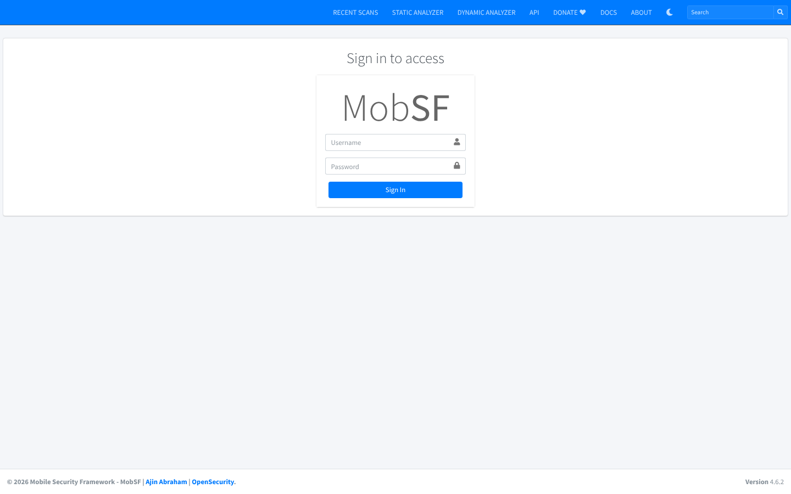

**Step 2.5 – Platform confirmed.** The dashboard (“Upload & Analyze”) loaded. **MobSF version: v4.6.2.**

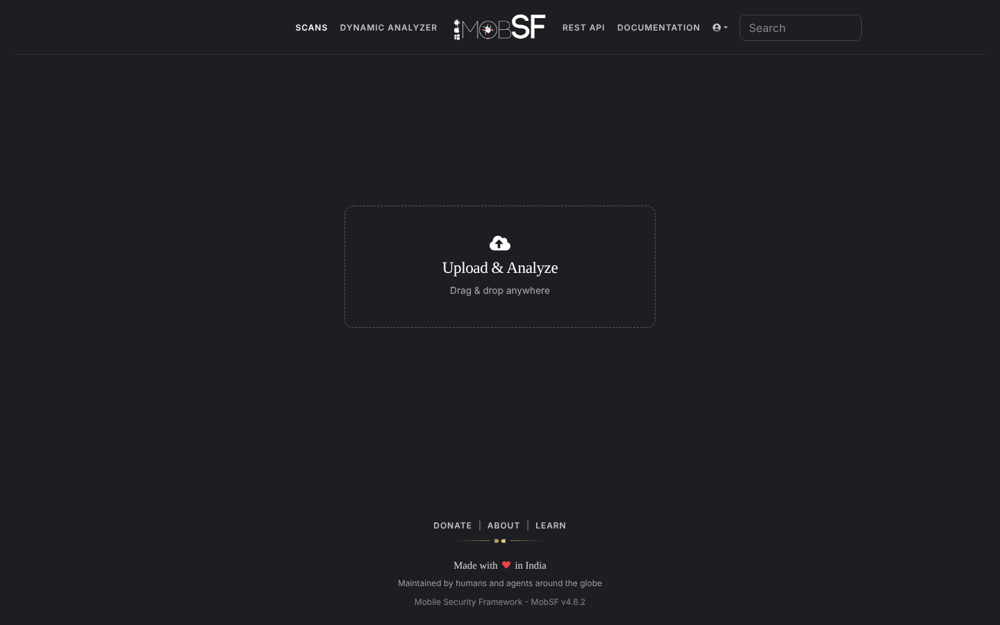

*Observation (documented setup difference):* MobSF downloads the JADX decompiler on first start. The lab container had no direct internet access, so the first scan logged “Decompiling with JADX failed” and produced an **empty code-analysis section**. The official JADX 1.5.0 release (the version MobSF requests) was placed in `~/.MobSF/tools/jadx/` and the container was restarted, because MobSF's anti-tampering check hashes tool binaries at start-up. The scan was then repeated. On a normal student PC with internet access this happens automatically.

# 8. Automated Security Assessment Procedure (Stage 3)

1. **Step 3.1 – Locate the APK:** `diva-app-debug.apk` from Stage 1 (SHA-256 above).
2. **Step 3.2 – Upload:** on the MobSF dashboard, *Upload & Analyze* → select `diva-app-debug.apk`. MobSF accepted the file (MIME `application/vnd.android.package-archive`) and created the scan hash `299b15c63aac6aae44ce42281e768b4c`.
3. **Step 3.3 – Automated analysis:** analysis was not interrupted. MobSF unpacked the APK, parsed it with androguard/aapt2, decoded the manifest with apktool, analysed the certificate and the five native libraries, ran APKiD, decompiled to Java (JADX 1.5.0) and Smali, and ran SAST, Android API, permission-mapping, behaviour, string/secret, URL and tracker analysis. The analysis took about 15 seconds.
4. **Step 3.4 – Review:** every section of the static-analysis report was reviewed (Figures 13–21).
5. **Step 3.5 – Evidence saved:** screenshots were captured, and the report was exported with *PDF Report* (`MobSF_Reports/MobSF_DIVA_report.pdf`, 25 pages). The full JSON report and the scorecard JSON were also exported.
6. **Step 3.6 – Metadata:** APK `diva-app-debug.apk`; MobSF **v4.6.2**; assessment date **28 October 2026** (scan timestamp 2026-10-28T18:02:33Z); app **Diva 1.0**, package `jakhar.aseem.diva`, main activity `.MainActivity`, target SDK 23, min SDK 15.

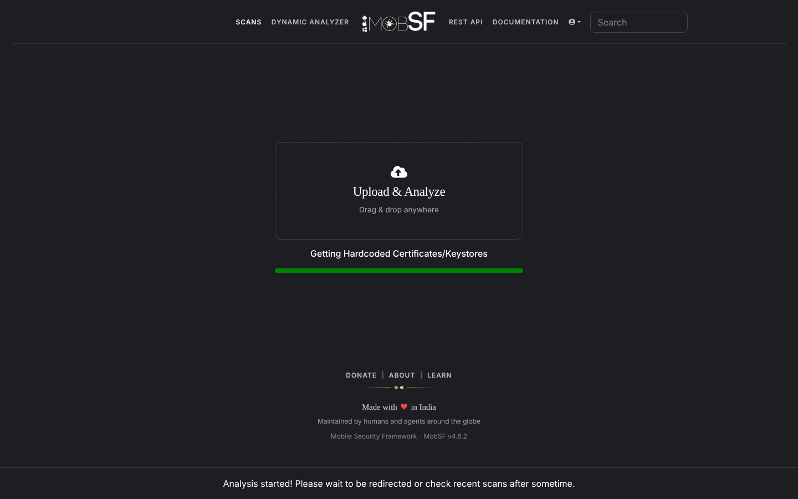

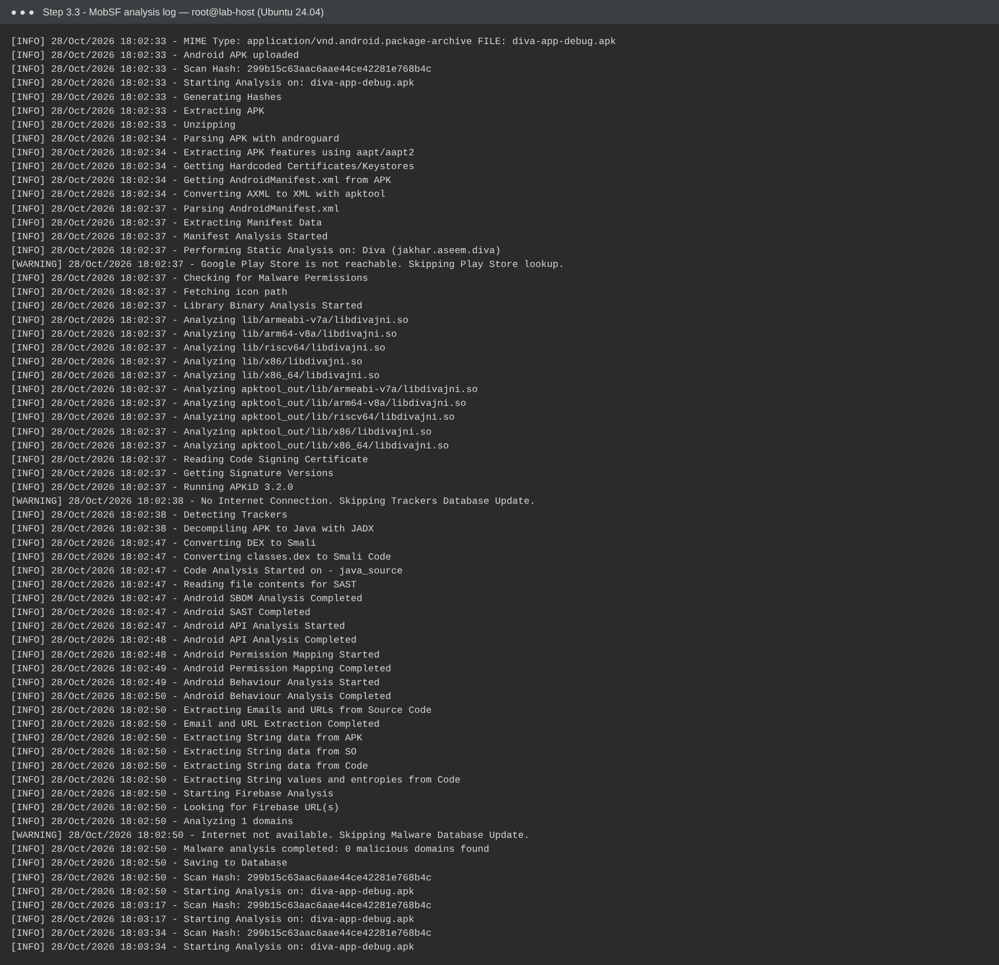


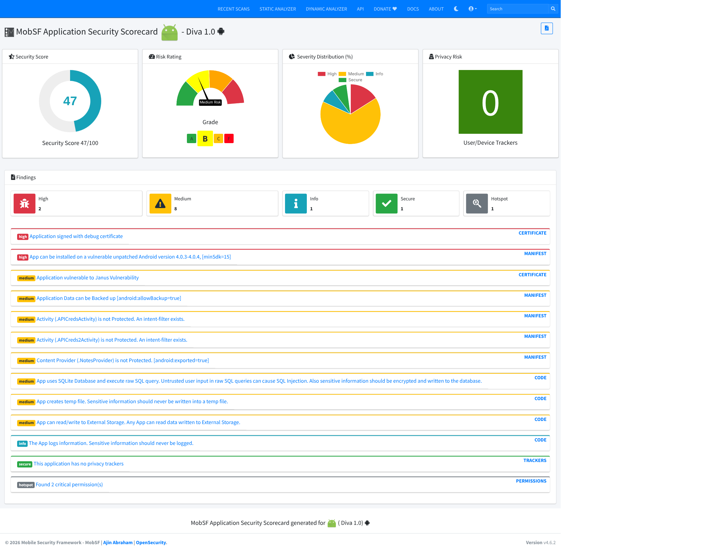

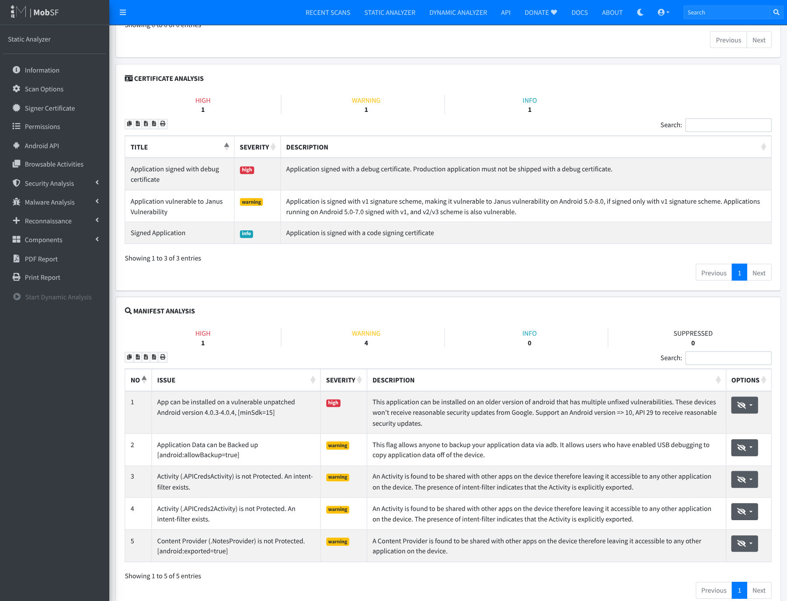

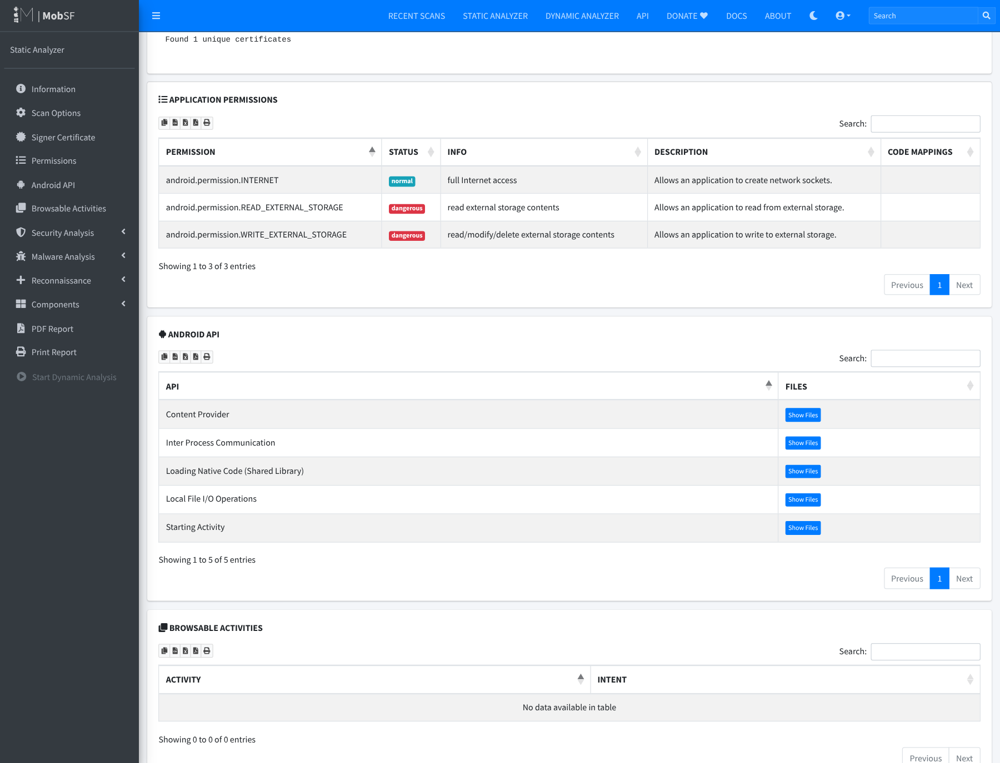


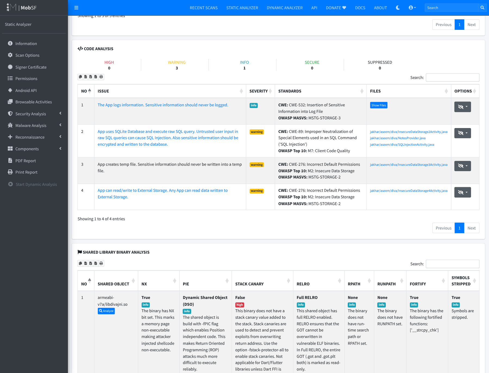


# 9. Assessment Results

**Overall MobSF result:** security score **47/100**, grade **B (Medium Risk)**, 0 trackers. Manifest analysis: 1 high, 4 warning. Code analysis: 3 warning, 1 info. Certificate: 1 high, 1 warning. Binary: no stack canary in all `libdivajni.so` builds. Exported components: 2/17 activities, 0 services, 0 receivers, 1/1 provider. Dangerous permissions: 2.

**Required Assessment Results Table (selected findings)**

| # | Finding | MobSF Severity | Evidence / Location | Security Impact | Recommended Fix |
|---|---|---|---|---|---|
| 1 | Content Provider `.NotesProvider` is not protected [`android:exported=true`] | **Warning** (Manifest; scorecard “medium”) | `AndroidManifest.xml` line 37: `<provider … exported="true" authorities="jakhar.aseem.diva.provider.notesprovider">` with no `android:permission`. `NotesProvider.java` `query()/update()/delete()` (decompiled lines 63–144) | Any app on the device, with no permissions, can read, modify and delete the PIN-protected private notes. This breaks confidentiality, integrity and authorization, and bypasses the PIN check in Access Control 3. | Set `android:exported="false"`. If sharing is needed, require a `signature`-level permission. Use parameterised selections. |
| 2 | Raw SQL query built from user input (SQL injection) | **Warning** — CWE-89, OWASP M7 | `SQLInjectionActivity.java` line 36: `rawQuery("SELECT * FROM sqliuser WHERE user = '" + input + "'", null)`. Plaintext passwords and card numbers stored at lines 23–26. Also `InsecureDataStorage2Activity`, `NotesProvider` | Input such as `' OR '1'='1` returns every row: all usernames, passwords and credit card numbers. Attackers can also bypass authentication-style lookups. Affects confidentiality and integrity. | Use parameterised queries (`rawQuery("… WHERE user = ?", new String[]{input})` or `SQLiteDatabase.query`). Validate input. Do not store passwords/PAN in plaintext. Encrypt the database (SQLCipher/Keystore). |
| 3 | App reads/writes External Storage (credentials stored world-readable) | **Warning** — CWE-276, OWASP M2, MSTG-STORAGE-2 | `InsecureDataStorage4Activity.java` line 26: `Environment.getExternalStorageDirectory()` → writes `username:password` to `/sdcard/.uinfo.txt`. Related: `InsecureDataStorage3Activity.java` line 25 `File.createTempFile("uinfo","tmp")` (warning) | Any app holding READ_EXTERNAL_STORAGE, a USB/adb user, or someone with the SD card can read third-party credentials in plaintext. The file stays after the app is uninstalled. | Do not store passwords. Use app-private internal storage (`getFilesDir()`) with Jetpack Security `EncryptedFile`/`EncryptedSharedPreferences` and Android Keystore keys. Remove the storage permissions. |
| 4 | Activities `.APICredsActivity` / `.APICreds2Activity` not protected (intent-filter exists) | **Warning** (Manifest) | `AndroidManifest.xml` lines 24–36: intent filters `jakhar.aseem.diva.action.VIEW_CREDS` / `VIEW_CREDS2` make them exported. `APICredsActivity` shows `API Key: 123secretapikey123 …` | Any app (or `adb shell am start -a jakhar.aseem.diva.action.VIEW_CREDS`) can open the screens and show vendor API credentials without the app's own checks. Authorization bypass leading to credential disclosure. | Remove the intent filters and set `android:exported="false"`, or protect with a `signature` permission. Check authorization inside the activity. Never ship API secrets in the client; issue short-lived tokens from a backend. |
| 5 | The app logs sensitive information | **Info** — CWE-532, MSTG-STORAGE-3 | `LogActivity.java` line 24: `Log.e("diva-log", "Error while processing transaction with credit card: " + cc)`. Further log calls in AccessControl1/2, InsecureDataStorage2/3/4, SQLInjection | Credit card numbers reach logcat, where adb users, crash/bug-report tools and (on Android ≤ 4.0, which minSdk 15 still allows) apps with READ_LOGS can read them. Privacy and PCI-DSS confidentiality impact. | Never log secrets or PAN. Remove or mask the values. Strip `Log.*` from release builds (R8/ProGuard `-assumenosideeffects`). Use a logging wrapper that is turned off in production. |

**Other notable MobSF results (not selected for detailed analysis):** application signed with a debug certificate (High); installable on unpatched Android 4.0.3–4.0.4, minSdk 15 (High); Janus/v1 signature (Warning); `android:allowBackup="true"` (Warning); `libdivajni.so` without stack canary (High, binary analysis); 2 dangerous storage permissions (Hotspot).

# 10. Detailed Analysis of Selected Findings (Stage 4)

**Prioritisation method (Step 4.5).** Priority combines (a) the MobSF severity, (b) the potential impact on the CIA properties and authorization, and (c) likelihood/exposure: who can trigger the flaw, whether a permission or user interaction is needed, and whether any app on the device can reach it. MobSF's severities are recorded unchanged. Where my remediation priority differs from MobSF's rating, the reason is given.

## 10.1 Finding 1 – Unprotected exported Content Provider (`.NotesProvider`) — Priority: **HIGH**

* **MobSF severity:** Warning (Manifest analysis; shown as “medium” in the scorecard). Also counted in the dashboard as *1/1 exported providers*.
* **What MobSF detected and where:** in the manifest, `<provider android:name=".NotesProvider" android:enabled="true" android:exported="true" android:authorities="jakhar.aseem.diva.provider.notesprovider"/>` has no `android:permission`, `readPermission` or `writePermission` (Figure 22, line 37). The provider (Figure 24) exposes `query`, `insert`, `update` and `delete` on the `notes` table of `divanotes.db`, and builds `"_id = " + uri.getLastPathSegment()` and caller-supplied `selection` strings directly into SQL.
* **Why it is a weakness:** an exported component is an IPC entry point that any other installed application can call. The app protects the notes behind a PIN in the UI (*Access Control 3*), but the provider exposes the same data with no access check. Access control is enforced only in the user interface, not at the data layer (CWE-926 / CWE-284).
* **Impact:** a malicious app with **no permissions** can run `content://jakhar.aseem.diva.provider.notesprovider/notes` and read every private note (confidentiality). It can also update or delete them (integrity, availability), and inject into `selection` to reach other tables. In a real app the same pattern would leak messages, health or financial records.
* **Why HIGH (although MobSF says warning):** exposure is maximal, because any co-installed app can exploit it silently, with no user interaction and no permission. The fix is trivial, so the risk-reduction-to-effort ratio is the best of all findings.

## 10.2 Finding 2 – SQL injection via raw query — Priority: **HIGH**

* **MobSF severity:** Warning — CWE-89 (SQL Injection), OWASP Mobile M7 (Client Code Quality).
* **What/where:** MobSF's rule `android_sql_raw_query` matched `SQLInjectionActivity.java` (decompiled lines 4 and 36), `InsecureDataStorage2Activity.java` and `NotesProvider.java`. At line 36 (Figure 23) the user's text is concatenated into the statement: `rawQuery("SELECT * FROM sqliuser WHERE user = '" + editText.getText() + "'", null)`. Lines 23–26 create the table with **plaintext** `password` and `credit_card` columns.
* **Why it is a weakness:** user input becomes part of the SQL grammar. A single quote breaks out of the string literal, so the attacker controls the query logic.
* **Impact:** entering `' OR '1'='1` makes the query return every row. The app then shows *all users, passwords and credit card numbers* (confidentiality). With other statements, data can be altered (integrity). The plaintext storage makes the impact worse, because the leaked data is directly usable. A real app would suffer account takeover and payment-card disclosure.
* **Why HIGH:** the flaw is directly exploitable and needs no special tools. It leads to full disclosure of the most sensitive data in the app.

## 10.3 Finding 3 – Credentials stored on external storage / temp files — Priority: **HIGH**

* **MobSF severity:** Warning — CWE-276 (Incorrect Default Permissions), OWASP M2 (Insecure Data Storage), MSTG-STORAGE-2. Related warning: *App creates temp file* (`InsecureDataStorage3Activity.java` line 25).
* **What/where:** `InsecureDataStorage4Activity.java` line 26 (Figure 25) calls `Environment.getExternalStorageDirectory()`, then writes `username + ":" + password` to `/sdcard/.uinfo.txt` and calls `setReadable(true)` / `setWritable(true)`. The app requests `WRITE_/READ_EXTERNAL_STORAGE` (Figure 16, flagged as “dangerous” and a Hotspot).
* **Why it is a weakness:** shared external storage is outside the Android application sandbox. On the app's target SDK (23), any app with storage permission can read it. A dot-prefixed file name only hides the file and does not protect it.
* **Impact:** third-party credentials are disclosed to other apps, backup tools, anyone with USB access, or someone who removes the SD card. The file stays after uninstall. This is a loss of confidentiality that leads to compromised third-party accounts (authentication).
* **Why HIGH:** the data is credentials, the storage location is world-readable by design, and exploiting it needs only a common permission.

## 10.4 Finding 4 – Exported activities with intent filters (`.APICredsActivity`, `.APICreds2Activity`) — Priority: **MEDIUM**

* **MobSF severity:** Warning (Manifest) — “Activity is not Protected. An intent-filter exists.” The dashboard shows *2/17 exported activities*.
* **What/where:** in the manifest (Figure 22, lines 24–36) the activities declare intent filters for the custom actions `jakhar.aseem.diva.action.VIEW_CREDS` / `VIEW_CREDS2` with `category.DEFAULT`. Because of this they are implicitly exported (target SDK 23), with no permission. `APICredsActivity` puts the string `"API Key: 123secretapikey123\nAPI User name: diva\nAPI Password: p@ssword"` on screen. `APICreds2Activity` is meant to require a PIN, but it trusts an intent extra.
* **Why it is a weakness:** an exported activity can be started by any app. Using intent filters for internal navigation exposes screens that should only be reached after an in-app check (CWE-926).
* **Impact:** `adb shell am start -a jakhar.aseem.diva.action.VIEW_CREDS`, or a malicious app, opens the credentials screen directly. That bypasses the authorization flow and discloses API credentials. Those could be used against the vendor backend.
* **Why MEDIUM:** the impact is credential disclosure, but exposure is lower than in Finding 1. The data appears on screen rather than being returned to the calling app, so harvesting it needs adb/screen access or a second weakness. The root problem, hardcoded API credentials in the client, also needs fixing.

## 10.5 Finding 5 – Sensitive information written to logs — Priority: **MEDIUM**

* **MobSF severity:** Info — CWE-532 (Insertion of Sensitive Information into Log File), MSTG-STORAGE-3. **MobSF's rating is kept as “info”.** I raise only the *remediation priority* to Medium, because the logged value is a full payment card number.
* **What/where:** `LogActivity.java` decompiled line 24 (Figure 26): `Log.e("diva-log", "Error while processing transaction with credit card: " + cctxt.getText())`. MobSF also lists log calls in AccessControl1/2, InsecureDataStorage2/3/4 and SQLInjectionActivity. Those mostly log exception messages and are lower risk.
* **Why it is a weakness:** logcat is a shared system facility. Its contents are kept in buffers, included in bug reports, read by crash-reporting SDKs, and visible to anyone using adb.
* **Impact:** cardholder data is disclosed (privacy, PCI-DSS). On Android 4.0.x, which is still allowed by minSdk 15, any app with `READ_LOGS` can read the logs of other apps.
* **Why MEDIUM:** reading the log needs adb, a bug report or a legacy device, so exposure is lower than for Findings 1–3. The data is still highly sensitive, and the fix is trivial.

## 10.6 Step 4.6 – Limitation / false positive requiring manual verification

1. **False positive – “Possible hardcoded secret” `"pkey" : "notespin"`** (Figure 20). Manual review of `res/values/strings.xml` (line 85) and `AccessControl3Activity.java` (line 72) shows that `notespin` is only the **name of the SharedPreferences key** under which the PIN is stored. It is not a secret. MobSF's entropy and keyword matching flagged it because of the name `pkey`.
2. **False negatives – real secrets that MobSF did not report as secrets.** `HardcodeActivity.java` compares input with the literal `"vendorsecretkey"` (Figure 27). `APICredsActivity` contains `123secretapikey123` and `p@ssword`. The native library contains the vendor key `olsdfgad;lh`, which appears only in the raw *Strings* list (Figure 20) and not under *Secrets*. `InsecureDataStorage1Activity` stores the password in plaintext SharedPreferences, which MobSF did not flag at all.
3. **Context-dependent “High” findings.** *Application signed with debug certificate* and *minSdk 15* are true for this lab build, but they come from how the build was configured, not from DIVA's code. A release build signed with a production key and minSdk ≥ 29 would remove them. They should be checked against the release artefact before being reported to a developer.
4. **Native buffer overflow only partly visible.** `divajni.c` copies user input into a 20-byte stack buffer with `strcpy` (*Input Validation 3*). MobSF reports only the missing stack canary. It also shows that FORTIFY replaced the call with `__strcpy_chk`, which, when the compiler knows the buffer size, aborts on overflow instead of letting it be exploited. Whether the overflow is still exploitable can only be confirmed dynamically, for example on an emulator with a long input, or under a debugger.

**Why manual verification is required:** static analysis matches patterns without runtime context. It cannot tell whether a string is really a credential, whether a code path can be reached, whether a component is protected at runtime, or whether a compiler mitigation already neutralises a bug. Confirming the findings needs manual code review plus dynamic testing on an emulator: MobSF dynamic analysis, `adb shell content query --uri content://jakhar.aseem.diva.provider.notesprovider/notes`, `adb shell am start -a jakhar.aseem.diva.action.VIEW_CREDS`, `adb logcat`, and Frida/drozer. These steps were out of scope for this static lab.

# 11. Remediation Recommendations (Stage 5)

| # | Finding | Root-cause remediation (Step 5.1) | How it reduces risk (Step 5.2) |
|---|---|---|---|
| 1 | Exported unprotected `NotesProvider` | Set `android:exported="false"` on the `<provider>` because it is used only internally. If another app genuinely needs it, declare `<permission android:name="jakhar.aseem.diva.permission.NOTES" android:protectionLevel="signature"/>` and set it as `android:readPermission`/`writePermission`. Replace the string-built `"_id = " + segment` with `selection "_id=?"` plus `selectionArgs`, and use `SQLiteQueryBuilder.setStrict(true)` and a projection map. | Removes the unauthenticated IPC entry point. Only the app itself (or apps signed with the same key) can reach the data, so access control is enforced at the data layer instead of only in the UI. Parameterisation removes the injection path through the provider. |
| 2 | SQL injection in `SQLInjectionActivity` | Use bound parameters: `db.rawQuery("SELECT user FROM sqliuser WHERE user = ?", new String[]{ input })`, or `db.query(...)` with `selectionArgs`. Return only the columns that are needed. Add server-side style input validation (allow-list for usernames). Do not store passwords (store a salted hash such as PBKDF2/bcrypt, or authenticate on the server). Do not store card numbers (use tokenisation), and encrypt the database (SQLCipher with a Keystore-protected key). | Bound parameters are passed as data and never parsed as SQL, so input cannot change the query. Hashing, tokenisation and encryption limit the damage even if the database is read some other way (defence in depth). |
| 3 | Credentials on external storage / temp file | Do not persist third-party passwords. Use an OAuth/refresh token where possible. If something must be stored, write it to app-private internal storage (`Context.getFilesDir()`, `MODE_PRIVATE`) with Jetpack Security `EncryptedFile`/`EncryptedSharedPreferences`, using a key from the Android Keystore. Delete temp files immediately, or keep them in `getCacheDir()`. Remove `WRITE_/READ_EXTERNAL_STORAGE` and raise `targetSdk` to get scoped storage. | Data moves inside the application sandbox, where other apps cannot read it. It is encrypted with a hardware-backed key, so even root/backup extraction gives only ciphertext. Removing the permissions shrinks the attack surface. |
| 4 | Exported `APICredsActivity` / `APICreds2Activity` | Remove the intent filters and set `android:exported="false"`, launching the activities with explicit intents from inside the app. If they must be exported, protect them with a `signature` permission and re-check authorization in `onCreate()` instead of trusting intent extras. Remove the hardcoded API key and password from the APK, and have the backend issue short-lived, per-user tokens after authentication. | Other apps can no longer start the screens to skip the authorization flow. Moving secrets to the server means nothing usable can be pulled from the client, even by reverse engineering. |
| 5 | Sensitive data in logs | Remove the card number from the log message (log an error code or a masked value such as `**** 5678`). Use a logging wrapper that is turned off in release builds, and add an R8/ProGuard rule `-assumenosideeffects class android.util.Log { public static *** d(...); public static *** e(...); … }`. Add a lint or code-review check that blocks logging of PII. | Sensitive values never reach logcat, bug reports or crash tools, so the leak is removed at its source. The release-build stripping protects against future mistakes. |

**Additional hardening for the other MobSF results:** sign release builds with a production key (APK Signature Scheme v2/v3+), raise `minSdkVersion` to ≥ 29 and `targetSdkVersion` to the current level, set `android:allowBackup="false"` (or add `dataExtractionRules`), and build the native library with `-fstack-protector-strong` and `-D_FORTIFY_SOURCE=2`. Replace `strcpy` with a length-checked copy such as `strlcpy`/`snprintf`, and release the JNI string with `ReleaseStringUTFChars`.

**Step 5.3 – First remediation priority: Finding 1 (exported, unprotected `NotesProvider`).** It is the only finding that any co-installed app can exploit silently, with no permission and no user interaction, and it gives full read/write access to private data, including injection through the provider. Setting `android:exported="false"` is a one-line change that removes the whole attack surface at once.

# 12. Limitations and Validation

* **Static analysis only.** MobSF examined the code and configuration without running the app. It cannot prove exploitability, detect runtime-only behaviour (dynamically loaded code, server-side logic, values decrypted at runtime) or see compiler and OS mitigations in action. See Section 10.6 for concrete examples of a false positive (`pkey: notespin`) and false negatives (`vendorsecretkey`, `123secretapikey123`, native key `olsdfgad;lh`, plaintext SharedPreferences).
* **Severity needs context.** MobSF's severities are generic. *Debug certificate* is “High” but expected for a lab debug build, while *logging of a credit card* is only “Info”. Analyst judgement (Section 10) is needed to rank by real exposure and impact.
* **Decompilation fidelity.** The line numbers MobSF reports refer to JADX-decompiled code, not to the original source files. Each one was checked against the original DIVA source before being cited.
* **Tool and environment dependencies.** The first scan silently produced no code findings because JADX was missing, although the report still rendered. This shows that the analyst must check the scan log (Figure 12) before trusting an empty section.
* **Build differences.** The APK was built with the SDK command-line toolchain (Section 6.4), and the native libraries target API 21+ because of NDK r29. Neither changes the Java code or the manifest that MobSF analysed. An Android Studio (AGP 8) build of `Source/diva-android/` will produce an APK with AndroidX libraries instead of support library 23.1.0. That changes library code, not DIVA's own findings.
* **Recommended validation (next phase):** run the APK on an Android emulator and confirm each finding dynamically, using MobSF Dynamic Analyzer, adb `content query`/`am start`/`logcat`, drozer, and Frida. Then retest after the remediation is in place.

# 13. Conclusion

The lab carried out CLO1 end to end. The DIVA target was built from source (native library plus APK), MobSF v4.6.2 was deployed with Docker, and an automated static assessment of the student-built APK was completed and documented. MobSF scored the app **47/100 (Grade B, Medium Risk)** and, within seconds, pointed to the main classes of weakness that DIVA is designed to teach: broken access control on exported components, SQL injection, insecure data storage, sensitive logging, and weak build and signing configuration.

Interpreting the results mattered as much as running the tool. Analyst review turned 13 raw results into a ranked list of five findings with evidence. One false positive was rejected, several hardcoded secrets that the tool missed were found, and two context-dependent High findings were identified. Based on the evidence, DIVA's security posture is **poor**. Sensitive data (notes, credentials, card numbers) can be reached by other apps or users through several independent paths, and the most urgent fix, making `NotesProvider` private, is also the cheapest. Automated assessment is an efficient first line of defence, but it must be combined with manual review and dynamic validation before conclusions are final.

# 14. References

1. Payatu, *DIVA Android – official source repository*. <https://github.com/payatu/diva-android>
2. Payatu, *DIVA Android – README / build instructions*. <https://github.com/payatu/diva-android#readme>
3. Google, *Android Studio – download*. <https://developer.android.com/studio>
4. Google, *Android Studio – installation guide*. <https://developer.android.com/studio/install>
5. MobSF, *Mobile Security Framework – GitHub project*. <https://github.com/MobSF/Mobile-Security-Framework-MobSF>
6. MobSF, *Official documentation*. <https://mobsf.github.io/docs/>
7. MobSF, *Running MobSF with Docker*. <https://github.com/MobSF/docs/blob/master/running_mobsf_docker.md>
8. Docker Inc., *Docker Desktop – download*. <https://www.docker.com/products/docker-desktop/>
9. Docker Inc., *Install Docker Desktop on Windows*. <https://docs.docker.com/desktop/setup/install/windows-install/>
10. OWASP, *Mobile Application Security Verification Standard (MASVS) / MASTG*. <https://mas.owasp.org/>
11. MITRE, *CWE-89, CWE-276, CWE-532, CWE-926*. <https://cwe.mitre.org/>
12. Google, *Android security best practices – content providers, data storage, logging*. <https://developer.android.com/privacy-and-security/security-tips>

# Appendix A – Screenshots and Evidence

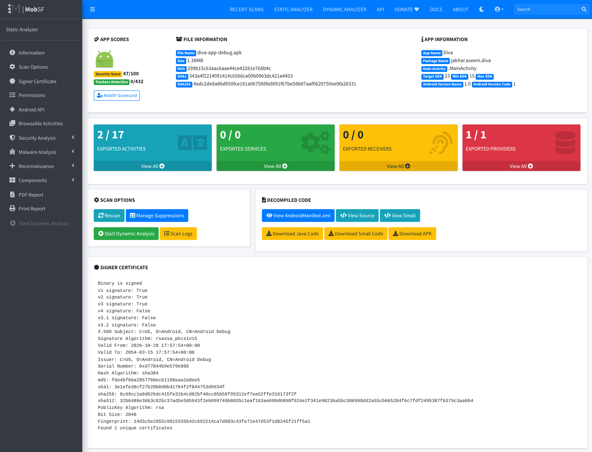


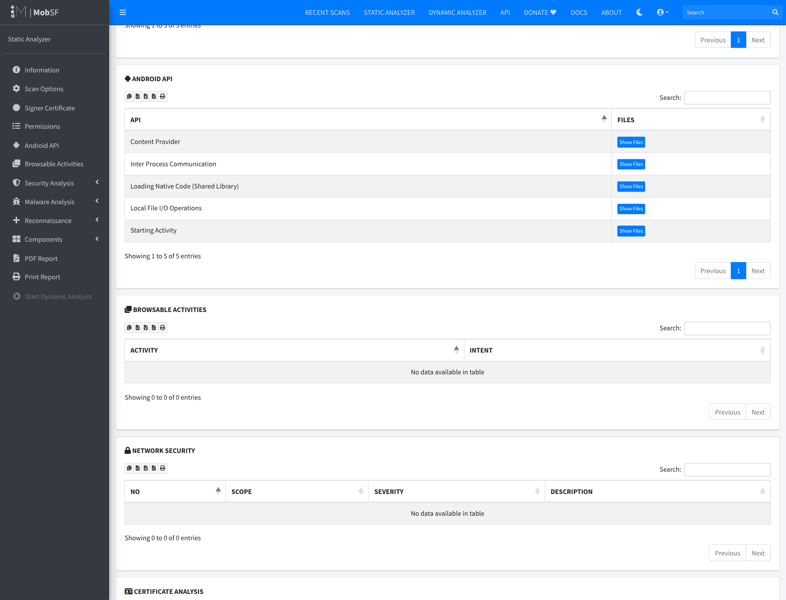

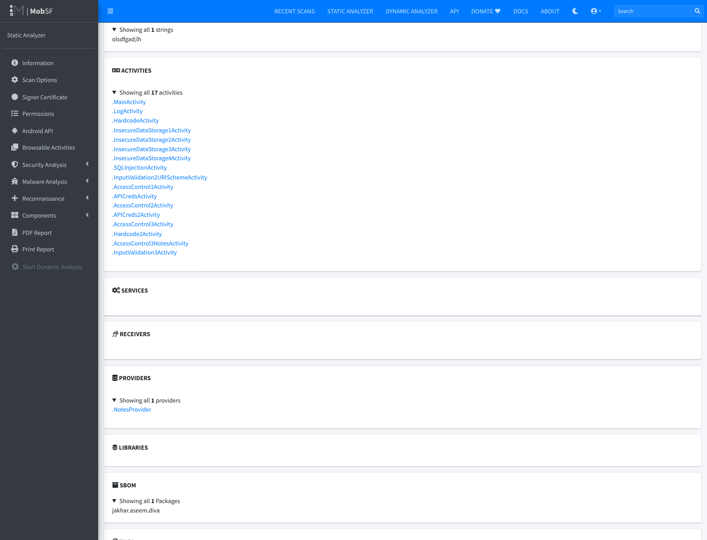

**Additional evidence:** the APK, MobSF's own 25-page PDF export, the JSON report, build logs and full-resolution screenshots are kept by the student and can be provided on request or shown during the demonstration.
